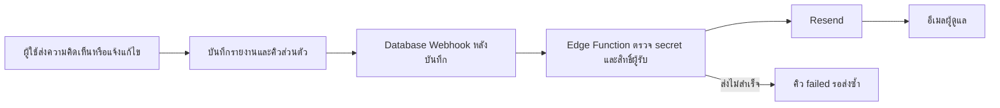
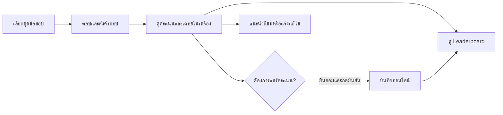

# แนวข้อสอบฝึก ป.5 — มงกุฎเพชร ครั้งที่ 3

เว็บข้อสอบฝึก **ไม่เป็นทางการ (Unofficial Practice Quiz)** สำหรับเตรียมสอบ **9 พฤศจิกายน 2569** ตามกรอบหัวข้อที่โรงเรียนแจ้งผู้ปกครอง ไม่ใช่ข้อสอบจริงและไม่ใช่เว็บไซต์โรงเรียน

**เว็บ:** https://miixel2.github.io/adr-cg32026-p5/

## ความสามารถ

- ข้อสอบ 145 ข้อ รวม 5 วิชา: คณิต 65 ข้อ (เศษส่วน 25 ทศนิยม 25 ข้อมูล 15) อังกฤษ 20 ข้อ ไทย 20 ข้อ สังคม/ประวัติศาสตร์ 20 ข้อ วิทยาศาสตร์ 20 ข้อ
- 9 ชุดฝึก รวมชุดจำลอง 5 วิชา 50 ข้อ **วิชาละ 10 ข้อเท่ากัน** (คณิต: เศษส่วน 4 + ทศนิยม 4 + ข้อมูล 2)
- ตอบผ่านมือถือ, จับเวลา, ตรวจคะแนนพร้อมคำอธิบาย, สรุปรายวิชา, ทำเฉพาะข้อผิด, ประวัติคะแนนในเบราว์เซอร์
- ธีมฟ้า–ทองสดใส มีการเคลื่อนไหวและรองรับการตั้งค่าลดการเคลื่อนไหวของระบบ
- Leaderboard แยกทั้ง 9 ชุด (เมื่อเชื่อม Supabase): เลือกบันทึกหรือไม่ก็ได้ ชื่อเล่นเป็นทางเลือก ถ้าเว้นว่างจะสุ่มชื่อให้อัตโนมัติ
- 💬 แนะนำติชมผ่านหน้าต่างรับความคิดเห็น พร้อมแจ้งแก้ไขโจทย์/เฉลยของข้อที่เลือก ข้อมูลส่งให้ผู้ดูแลเท่านั้น
- 🛠️ `feedback.html`: ผู้ดูแลเข้าสู่ระบบเพื่ออ่านรายงาน บันทึกหมายเหตุ แก้ไขสถานะ เก็บเข้าคลัง หรือลบถาวร
- 📖 `review.html`: ดูโจทย์และเฉลยครบทุกข้อ ค้นหา กรองวิชา/หัวข้อ ขยาย/ย่อรายข้อหรือทั้งหมด และส่งรายงานแก้ไขรายข้อ
- 🐣 `tutorial.html`: คู่มือสั้น 5 ขั้นตอน พร้อมน้องจิ๋วและตัวอย่างกดเล่นแบบมีแอนิเมชัน ไม่ส่งข้อมูลจริง และรองรับ reduced motion

> **สำคัญเรื่อง CI โรงเรียน**: ธีมฟ้า–ทองนี้เป็นการออกแบบเบื้องต้น **ยังไม่ใช่รหัสสีประจำโรงเรียนที่ยืนยันแล้ว** สามารถแก้ CSS Variables ในไฟล์ theme.css ได้แก่ --school-primary, --school-primary-dark, --school-gold เมื่อได้โลโก้หรือคู่มือ CI ของโรงเรียนจริง หลีกเลี่ยงการนำโลโก้โรงเรียนมาใช้โดยไม่ได้รับอนุญาต

## เปิดเว็บบน GitHub Pages

Settings → Pages → Deploy from a branch → main → /(root) → Save

### โครงสร้างไฟล์

- index.html / quiz.js: หน้าแบบฝึกหัดและการทำข้อสอบ
- question-bank.js: คำถามทั้ง 145 ข้อ พร้อมเฉลย คำอธิบาย และกราฟ ใช้ร่วมกันระหว่างแบบฝึกหัดกับหน้าตรวจทาน
- extra-questions.js: การจัดชุดฝึกทั้ง 5 วิชาและการกระจายน้ำหนักการสอบ
- review.html / review.js / review.css: หน้าตรวจทานข้อสอบ ค้นหา กรอง และขยาย/ย่อเนื้อหา
- tutorial.html / tutorial.js / tutorial.css: คู่มือใช้งานแบบกดเล่นสำหรับผู้ใช้ใหม่
- theme.css: สี ฟอนต์ ทรานสิชั่น และ Animation
- leaderboard.js: เลือกบันทึกคะแนน, สุ่มชื่อเล่น, แสดงอันดับ
- config.js: กำหนด Supabase URL และ Public Key (เริ่มต้นเว้นว่าง)
- supabase/leaderboard.sql: ตารางพร้อม Answer Keys, RLS, ฟังก์ชันรับ/คำนวณคะแนนและอ่านอันดับ

## เปิดใช้งาน Leaderboard ฟรีด้วย Supabase PostgreSQL

**Leaderboard ยังไม่เชื่อมจริงจนกว่าจะตั้งค่า Supabase ต่อไปนี้** หากยังไม่ตั้งค่า เว็บข้อสอบและประวัติในเครื่องทำงานได้ปกติ

1. สร้าง Project ใหม่ที่ https://supabase.com บน Free Plan
2. ใน Authentication → Sign In / Providers → เปิด **Allow new users to sign up** และ **Allow anonymous sign-ins**
3. ใน SQL Editor รันไฟล์ [supabase/leaderboard.sql](supabase/leaderboard.sql) ทั้งไฟล์
4. ที่ Project Settings → API หรือ Connect คัดลอก Project URL และ **publishable key** หรือ legacy **anon key** (ใช้ได้เฉพาะ Public Client Key)
5. แก้ไขไฟล์ config.js ใน GitHub เป็นค่า Project ของตัวเอง

   ~~~js
   window.QUIZ_CONFIG = {
     supabaseUrl: 'https://YOUR-PROJECT.supabase.co',
     supabaseAnonKey: 'YOUR-PUBLISHABLE-OR-ANON-KEY'
   };
   ~~~

6. Commit แล้ว Refresh เว็บ ทำข้อสอบ → ส่งคำตอบ → ติ๊กยินยอม → ระบุชื่อเล่นหรือเว้นว่าง → กดบันทึก
7. ที่หน้าแรก เลือกชุดใน Leaderboard เพื่อดู Top 15

**ห้ามใส่ service_role key หรือ secret key ใน Repository** เพราะเป็นเว็บ Public และข้อมูลทุกอย่างใน JavaScript ถูกอ่านได้ ตารางเปิด RLS แต่ไม่ให้ Client เขียน/อ่านตรง ๆ; รับส่งผ่าน RPC ที่กำหนดสิทธิ์เท่านั้น และฐานข้อมูลคำนวณคะแนนใหม่จากคำตอบที่ส่งมา

### การป้องกันการปั่นคะแนน

- RPC ตรวจจำนวนข้อ, Question ID ไม่ซ้ำ, ชุดวิชาตรงกับแบบทดสอบ, Answer Index และคำนวณคะแนนตาม Answer Key ฝั่งฐานข้อมูล
- Supabase Anonymous Auth ออก User ID โดยไม่ต้องให้เด็กสมัครด้วยอีเมล; จำกัดส่งซ้ำ 30 วินาที/ผู้ใช้/ชุด
- 1 User ID ต่อ 1 ชุดมีคะแนนดีที่สุดหนึ่งรายการ ไม่จัดอันดับจากระยะเวลาเพราะ Client จับเวลาเอง
- **ข้อจำกัดสำคัญ**: โจทย์/เฉลยอยู่ในไฟล์ JavaScript ที่เผยแพร่สาธารณะ และโหมดฝึกสามารถเฉลยระหว่างทำได้ จึงไม่สามารถป้องกันการดูเฉลย การสร้างบัญชี Anonymous ใหม่ หรือการปลอมคำตอบได้อย่างสมบูรณ์ Leaderboard นี้เหมาะใช้สนุกและสร้างแรงจูงใจ ไม่ใช่การแข่งขันทางการ
- หากมีผู้ใช้งานจำนวนมาก แนะนำเพิ่ม CAPTCHA/Turnstile, ตรวจชื่อไม่เหมาะสม, การรายงานและลบข้อมูล และ Server-side Exam Session หากต้องการแข่งจริง

**Free Tier ที่ตรวจสอบ ต.ค. 2569:** ฟรีสูงสุด 2 Active Projects, DB 500 MB/Project, 50,000 MAU, 5 GB Egress, Project Free อาจ Pause หลังไม่มีการใช้งาน 7 วัน — ตรวจรายละเอียดที่ https://supabase.com/pricing

## ความเป็นส่วนตัวสำหรับเด็ก

- ข้อสอบและประวัติคะแนนในเครื่อง **ไม่จำเป็นต้องส่งข้อมูลไปฐานข้อมูล**
- เฉพาะเมื่อผู้ใช้เลือก Checkbox **และกดปุ่มยืนยัน** จึงส่งข้อมูลเพื่อบันทึกอันดับ
- แสดงต่อสาธารณะเฉพาะ **ชื่อเล่น คะแนน ชุดข้อสอบ วันที่** ไม่ขอชื่อจริง อีเมล เบอร์โทร
- ระบบ Anonymous Auth สร้าง ID ไม่ระบุชื่อในระบบ Auth; คะแนนดีที่สุดผูกกับ ID นี้ หากล้าง Browser หรือเปลี่ยนเครื่องจะเรียกบัญชี Anonymous เดิมไม่ได้
- ควรใช้ชื่อเล่นสมมติ ไม่กรอกข้อมูลส่วนบุคคล
- 💬 ความคิดเห็นจะส่งขึ้นออนไลน์เฉพาะเมื่อกด **ส่งความคิดเห็น** ไม่ขอข้อมูลติดต่อ และไม่เผยแพร่รายงานต่อสาธารณะ
- **ปัจจุบันไม่มีปุ่มลบคะแนนออนไลน์สำหรับผู้เล่น** หากมีคำขอลบ ผู้ดูแล Supabase ต้องลบผ่าน Dashboard จึงควรจัดเตรียมช่องทางติดต่อผู้ดูแลก่อนประชาสัมพันธ์ต่อเด็กจำนวนมาก

## 💬 เปิดใช้งานแนะนำติชมและหน้าผู้ดูแล

- 🗃️ รัน [supabase/feedback.sql](supabase/feedback.sql) ใน Supabase SQL Editor **หลังจาก** `leaderboard.sql` สคริปต์สร้าง `quiz_feedback`, รายชื่อผู้ดูแล `feedback_admins`, RLS และ RPC รับความคิดเห็น รันซ้ำได้โดยไม่ลบรายงานเดิม
- 🔑 ใน Authentication → Sign In / Providers เปิด **Email** สำหรับการเข้าสู่ระบบผู้ดูแล และคง **Allow new users to sign up / Allow anonymous sign-ins** ไว้สำหรับผู้เล่น
- 👤 สร้างบัญชีผู้ดูแลแบบ Email/Password ใน Authentication → Users → Add user และยืนยันอีเมลบัญชีนั้น จากนั้นคัดลอก **User UID** บัญชีต้องเป็น permanent user ไม่ใช่ anonymous user
- 🛡️ เพิ่มเฉพาะ UID ของ repository maintainer ผ่าน SQL Editor ไม่ใส่รหัสผ่านหรือ secret key ใน repo:

  ~~~sql
  insert into public.feedback_admins(user_id)
  values ('REPLACE-WITH-MAINTAINER-AUTH-USER-UUID')
  on conflict (user_id) do nothing;
  ~~~

- 🛠️ เปิด `https://miixel2.github.io/adr-cg32026-p5/feedback.html` โดยตรง ไม่มีลิงก์หน้านี้จากหน้าแบบฝึกหัด เข้าสู่ระบบด้วยบัญชีที่อนุญาตไว้
- ✅ ผู้ดูแลกรองตามสถานะ/ประเภท บันทึกหมายเหตุ ทำเครื่องหมายแก้ไขแล้ว เปิดใหม่ เก็บเข้าคลัง และลบถาวรพร้อมยืนยันได้ รายการแบ่งหน้าละ 20 รายงาน
- 📝 สถานะหรือหมายเหตุ **ไม่แก้โจทย์อัตโนมัติ** เมื่อตรวจแล้ว ให้แก้ข้อมูลข้อสอบใน repo และ `quiz_answer_keys` ถ้าเฉลยเปลี่ยน รายงานเก็บภาพข้อความโจทย์และเฉลย ณ วันที่ส่งเพื่อให้ตรวจย้อนหลังได้
- 🚫 ถอนสิทธิ์ด้วย `delete from public.feedback_admins where user_id = 'THE-UUID';` ผู้ใช้ทั่วไป/anonymous ไม่สามารถอ่าน แก้ไข หรือลบรายงาน และไม่มีสิทธิ์เพิ่มตนเองเป็นผู้ดูแล
- 🔒 GitHub Pages ให้บริการไฟล์ HTML/JavaScript ต่อสาธารณะได้ จึงซ่อน **เนื้อหารายงานและการจัดการ** ด้วย Supabase Auth + RLS ไม่ใช้ URL ลับเป็นระบบสิทธิ์ และ `noindex` เป็นเพียงคำขอไม่ให้ค้นพบหน้า ไม่ใช่การควบคุมการเข้าถึง การให้สิทธิ์ repo ไม่ได้เพิ่มสิทธิ์ Supabase โดยอัตโนมัติ
- 🧭 Session ผู้ดูแลแยกจากผู้เล่น เก็บใน `sessionStorage` ของแท็บด้วย key `quiz-feedback-admin` การออกจากระบบผู้ดูแลไม่ออกจากบัญชี anonymous ที่ใช้บันทึกคะแนน
- ⏱️ รับความคิดเห็นผ่าน RPC เท่านั้น จำกัด 1 รายงานต่อ 60 วินาที/ผู้ใช้ พร้อมตรวจความยาวและ Question ID ฝั่งฐานข้อมูล หากใช้งานสาธารณะในวงกว้าง ควรเปิด CAPTCHA สำหรับ anonymous sign-in; การจำกัดตาม User ID อย่างเดียวไม่ป้องกันผู้สร้างหลายบัญชี
- 🧪 ตรวจหลังตั้งค่าจริง: ส่งคำแนะนำทั่วไป → ส่งรายงานแก้ไขข้อสอบ → บัญชีทั่วไปอ่านรายงานไม่ได้ → ผู้ดูแลเห็นและเปลี่ยนสถานะได้ → บัญชีที่ถอนสิทธิ์จัดการไม่ได้ ใช้ไฟล์ [supabase/tests/feedback-security.sql](supabase/tests/feedback-security.sql) ตรวจสิทธิ์แบบ rollback ใน SQL Editor ได้

### ไฟล์ความคิดเห็น

- `supabase-client.js`: โหลด SDK และแชร์ client ผู้เล่น พร้อมแยก session ผู้ดูแล
- `feedback-widget.js` / `feedback.css`: ปุ่มแนะนำติชมและ dialog ที่รองรับคีย์บอร์ด/มือถือ
- `feedback.html` / `feedback-admin.js`: หน้าจัดการเฉพาะผู้ดูแล ไม่มีลิงก์จากหน้าแรก
- `supabase/feedback.sql`: migration ของฐานข้อมูลและสิทธิ์

## 📊 คะแนนเฉลี่ยและเปอร์เซ็นไทล์ใน Leaderboard

- 🗃️ รัน [supabase/leaderboard-stats.sql](supabase/leaderboard-stats.sql) ใน Supabase SQL Editor หลัง `leaderboard.sql` เพื่อเปิดกราฟสถิติ ไม่ต้องเปลี่ยน public API key รันซ้ำได้โดยไม่ลบคะแนน
- 📊 กราฟเปรียบเทียบค่าเฉลี่ยของทุกคนกับคะแนนดีที่สุดที่ผู้ใช้ปัจจุบันแชร์ แยกตามชุดข้อสอบ ใช้เปอร์เซ็นต์คะแนนเพื่อเปรียบเทียบชุดที่จำนวนข้อไม่เท่ากัน และระบุจำนวนผู้ร่วมทุกชุด
- 🧮 ค่าเฉลี่ยคำนวณจาก **ทุกคะแนนที่แชร์** ไม่ใช่เพียง 15 อันดับแรก แต่ละคนมีคะแนนดีที่สุดหนึ่งรายการต่อชุด เปอร์เซ็นไทล์ = จำนวนคนที่คะแนนเป็นเปอร์เซ็นต์ต่ำกว่าคุณ ÷ จำนวนผู้ร่วมชุดทั้งหมด × 100 คะแนนเท่ากันไม่นับว่าต่ำกว่า แสดงเมื่อมีอย่างน้อย 5 คนเท่านั้น
- 👤 คะแนนของคุณอ้างอิง session ผู้เล่นเดิม ไม่สร้างบัญชีหรือส่งผลสอบในเครื่องเพียงเพื่อเปิดกราฟ หากยังไม่แชร์ชุดนั้น จะแสดงเฉพาะค่าเฉลี่ย ถ้าล้างข้อมูล Browser หรือเปลี่ยนเครื่องจะไม่สามารถระบุคะแนนของ anonymous account เดิมได้
- 📝 ชุดจำลองรวมหลายหัวข้อแสดงคะแนนรวมของชุด ยังไม่มีข้อมูลคะแนนแยกรายวิชาของชุดจำลองในฐานข้อมูล สถิติเป็นของผู้สมัครใจแชร์ ไม่ใช่ตัวแทนผู้สอบทั้งหมดหรือผลสอบจริง
- 🧪 [supabase/tests/leaderboard-stats.sql](supabase/tests/leaderboard-stats.sql) ตรวจค่าเฉลี่ย คะแนนเท่ากัน กลุ่มตัวอย่างน้อย และสิทธิ์แบบ rollback ควรรันผ่าน SQL Editor ทั้งไฟล์โดยไม่แยก statement ออกจาก transaction

## 📧 แจ้งเตือนผู้ดูแลเมื่อมีรายงานใหม่

- ⏸️ **ปิดการส่งอีเมลเป็นค่าเริ่มต้น** เปิดภายหลังได้ด้วย Supabase Edge Function secret `FEEDBACK_EMAIL_ENABLED=true`; ปิดด้วย `false` หรือลบ secret นี้ ต้องใช้ค่า `true` ตัวพิมพ์เล็กตรงตัว ไม่ใช้ `config.js` ฝั่ง Browser
- 🛠️ หาก deploy รุ่นก่อนหน้าที่ไม่มี toggle แล้ว ต้อง deploy `notify-feedback` รุ่นนี้ก่อนจึงจะใช้สวิตช์ได้ การเปิด/ปิดภายหลังเปลี่ยนเฉพาะ secret ได้ ไม่ต้องแก้หน้าเว็บ
- 📝 ขณะปิด ผู้ใช้ยังส่งความคิดเห็นและผู้ดูแลจัดการได้ตามปกติ หากติดตั้ง migration/webhook แล้ว คิวใหม่ยังคงเป็น `pending` แต่ function ตอบ `disabled` โดยไม่ claim งานหรือเรียกบริการอีเมล เมื่อเปิดอีกครั้งจะส่งเฉพาะ webhook ใหม่ ไม่ส่งคิวเก่าย้อนหลังอัตโนมัติ คิวเก่าส่งซ้ำด้วยวิธีด้านล่างได้เมื่อเปิดแล้ว
- ✉️ รองรับทั้ง **แนะนำติชมทั่วไป** และ **ขอตรวจทาน/แก้ไขข้อสอบ** ส่งแยกถึงอีเมลที่ยืนยันแล้วของทุกบัญชีใน `feedback_admins` ไม่รับที่อยู่อีเมลผู้รับจาก Browser
- 🔒 อีเมลมีประเภท รหัสรายงาน ลิงก์หน้าผู้ดูแล และลิงก์ข้อสอบเมื่อเกี่ยวข้อง ข้อความฉบับเต็มและข้อมูลผู้ส่งไม่แนบไปด้วย ผู้ดูแลยังต้องเข้าสู่ระบบเพื่ออ่านรายงาน
- 🗃️ รัน [supabase/feedback-notifications.sql](supabase/feedback-notifications.sql) หลัง `feedback.sql` สร้างคิวส่วนตัว `feedback_email_notifications` รันซ้ำได้ ไม่มีอีเมลย้อนหลังสำหรับรายงานเก่าหรือบัญชีที่เพิ่งเพิ่มสิทธิ์

### ตั้งค่าครั้งแรก

1. 📮 สร้าง API key ใน Resend และยืนยันโดเมนสำหรับที่อยู่ผู้ส่ง ตาม [Resend domain setup](https://resend.com/docs/dashboard/domains/introduction)
2. 🔑 ตั้งค่า **Edge Function secrets** ใน Supabase Dashboard โดยไม่ใส่ค่าเหล่านี้ใน `config.js`, HTML หรือ Git:

   | Secret | ค่า |
   | --- | --- |
   | `FEEDBACK_EMAIL_ENABLED` | `false` ตอนนี้; เปลี่ยนเป็น `true` เมื่อพร้อมส่งอีเมล |
   | `RESEND_API_KEY` | API key ของ Resend |
   | `FEEDBACK_EMAIL_FROM` | เช่น `Quiz P5 <quiz@YOUR-VERIFIED-DOMAIN>` |
   | `FEEDBACK_WEBHOOK_SECRET` | ค่าสุ่มยาวอย่างน้อย 32 ตัวอักษร ใช้ค่าตรงกันกับ webhook header |
   | `QUIZ_APP_URL` | `https://miixel2.github.io/adr-cg32026-p5/` |

   `SUPABASE_URL` และ `SUPABASE_SERVICE_ROLE_KEY` เป็นค่า server ที่ Supabase Edge Functions จัดให้ เก็บไว้ฝั่ง server เท่านั้น ดู [คู่มือ secrets](https://supabase.com/docs/guides/functions/secrets)

3. 🚀 หลังติดตั้ง Supabase CLI และเข้าสู่ระบบ ให้ deploy จาก root ของ repo:

   ```sh
   supabase functions deploy notify-feedback --project-ref wvyilmmaobuzzoyfkvue --no-verify-jwt
   ```

   [supabase/config.toml](supabase/config.toml) ปิด JWT verification เฉพาะ function นี้ เพราะ Database Webhook ใช้ secret header แทน ตัว handler ตรวจ secret ก่อนอ่านฐานข้อมูลหรือส่งอีเมล

4. 🔗 ใน Supabase Database → Webhooks สร้าง webhook สำหรับตาราง **`public.feedback_email_notifications`**, event **INSERT เท่านั้น**, method **POST**, URL `https://wvyilmmaobuzzoyfkvue.supabase.co/functions/v1/notify-feedback` ใส่ headers `Content-Type: application/json` และ `x-feedback-webhook-secret: YOUR-SECRET` ไม่เลือกตาราง `quiz_feedback` หรือ event UPDATE ดู [Database Webhooks](https://supabase.com/docs/guides/database/webhooks)
5. ✅ เมื่อพร้อมเปิด ให้ตั้ง `FEEDBACK_EMAIL_ENABLED=true` แล้วส่งความคิดเห็นจริงหนึ่งรายการและแจ้งแก้ไขหนึ่งข้อ ตรวจคิวเป็น `sent` พร้อม `provider_message_id`, ดูรายการส่งใน Resend และตรวจกล่องจดหมายผู้ดูแล `sent` หมายถึง provider รับคำขอแล้ว ไม่ใช่ยืนยันว่าเข้า inbox



### ตรวจสอบและส่งซ้ำ

- 🔍 ตรวจ `status`, `attempts`, `last_error` ใน Table Editor ของ `feedback_email_notifications` ผู้เล่นและบัญชีผู้ดูแลที่ใช้ public API key อ่านหรือแก้คิวนี้ไม่ได้
- ⏱️ Webhook ทำงานแบบ asynchronous ความล้มเหลวของบริการอีเมลไม่ย้อนกลับรายงานที่บันทึกแล้ว **ยังไม่มี scheduler ส่งซ้ำอัตโนมัติ** เมื่อ webhook ไม่ถึง function งานอาจค้าง `pending`; worker ที่หยุดกลางทางค้าง `sending` และ claim ใหม่ได้หลัง 2 นาที
- 🔄 หลังแก้สาเหตุ ให้ผู้ดูแลระบบใช้ Edge Function Test ใน Dashboard เรียก POST พร้อม secret header เดิมและ JSON ด้านล่าง โดยแทนสอง ID จากแถวคิว ไม่ส่ง secret จากหน้าเว็บสาธารณะ:

  ```json
  {
    "type": "INSERT",
    "schema": "public",
    "table": "feedback_email_notifications",
    "record": {
      "feedback_id": "REPLACE-WITH-FEEDBACK-UUID",
      "admin_user_id": "REPLACE-WITH-ADMIN-UUID"
    }
  }
  ```

- 🛡️ งานที่ส่งแล้วไม่ส่งซ้ำ มี lease ป้องกัน worker ซ้อนกัน และใช้ [Resend idempotency key](https://resend.com/docs/dashboard/emails/idempotency-keys) อายุ 24 ชั่วโมง หาก provider รับอีเมลแล้วแต่ฐานข้อมูลบันทึกผลไม่ได้ ให้ตรวจ Resend ก่อน retry หลัง 24 ชั่วโมงเพราะอาจเกิดอีเมลซ้ำได้ ไม่เปลี่ยน sender หรือ URL ระหว่าง retry ของงานเดียวกัน
- 👤 ทุกครั้งที่ claim จะตรวจ allowlist และอีเมลยืนยันอีกครั้ง การถอนสิทธิ์ลบคิวของบัญชีนั้น หากเปลี่ยนอีเมล งานเดิมจะไม่ส่งไปที่อยู่เก่า ให้ตรวจคิวก่อนส่งใหม่ อีเมลที่ส่งไปแล้วเรียกคืนไม่ได้
- 🧪 ทดสอบ handler แบบ mock ไม่ส่งอีเมลจริง: `node --test supabase/functions/notify-feedback/handler.test.mjs` และตรวจ SQL แบบ rollback ด้วย [feedback-notifications-security.sql](supabase/tests/feedback-notifications-security.sql)

## 📖 ส่งให้ผู้ตรวจทาน

- 🔗 เปิด `https://miixel2.github.io/adr-cg32026-p5/review.html` เพื่อดูโจทย์ ตัวเลือก เฉลย คำอธิบาย และกราฟ ครบทุกข้อโดยไม่ต้องทำข้อสอบหรือเข้าสู่ระบบ
- 🔎 ค้นหาจาก Question ID, ข้อความโจทย์, ตัวเลือก หรือคำอธิบาย เช่น `Q069` หรือ `rice` กรองวิชาและหัวข้อร่วมกับคำค้นได้ และ URL เก็บตัวกรองสำหรับส่งต่อ
- 📂 ข้อสอบเริ่มต้นในสถานะย่อ กดที่โจทย์เพื่อขยาย/ย่อ ปุ่ม **ขยายทั้งหมด / ย่อทั้งหมด** มีผลเฉพาะข้อที่ตรงกับตัวกรองและรักษาสถานะของข้อที่ถูกซ่อนไว้
- 📌 ลิงก์รายข้อ เช่น `review.html#Q069` เปิดข้อที่เลือกโดยตรง ตัวกรองเดิมที่ไม่ตรงจะถูกล้างเพื่อไม่ให้ลิงก์ซ่อนข้อเป้าหมาย
- 📝 **แจ้งแก้ไขข้อนี้** เปิด dialog พร้อมเลือก Question ID ให้แล้ว การอ่านไม่ส่งข้อมูลขึ้น Supabase; ส่งรายงานเมื่อกดส่งเท่านั้น
- 🖨️ **พิมพ์ / บันทึก PDF** แสดงรายละเอียดและเฉลยของข้อที่ตรงกับตัวกรอง เมื่อปิดหน้าพิมพ์ สถานะการขยาย/ย่อกลับเหมือนเดิม
- 🔄 แก้โจทย์/เฉลยใน `question-bank.js` เพียงแห่งเดียว หน้าแบบฝึกหัดและหน้าตรวจทานใช้ข้อมูลเดียวกัน หากเปลี่ยนเฉลยให้ปรับ `quiz_answer_keys` ใน Supabase ให้ตรงกันด้วย

## 🐣 คู่มือใช้งานแบบสั้น

- 🔗 เปิด `tutorial.html` หรือกด **วิธีใช้แบบฝึกหัด** ที่หน้าแรก
- 👆 ลองกดเลือกชุด ตอบและส่งคำตอบ ติ๊กยินยอมบันทึกคะแนน เปิดอันดับ และส่งความคิดเห็นตัวอย่าง
- 🎭 ตัวอย่างทั้งหมดเป็นการสาธิต ไม่จับเวลา ไม่บันทึกข้อมูล และไม่เรียก Supabase แอนิเมชันเล่นเฉพาะเมื่อกดและหยุดเมื่อจบ ระบบลดการเคลื่อนไหวปิดการกระโดดของตัวละครแต่ยังแสดงผลของการกดครบถ้วน



## การตรวจทานเนื้อหา

ตรวจโจทย์เดิม 111 ข้อ, ปรับความกำกวมในคำอธิบายของบางข้อ, เพิ่มโจทย์ใหม่ 34 ข้อ ครอบคลุมทุกวิชา ตรวจทางเทคนิคแล้วว่า **145 Question IDs ไม่ซ้ำ, ข้อละ 4 ตัวเลือก, Answer Index 0–3, มีคำอธิบายทุกข้อ และ SQL Seed 145 รายการตรงกับคำถามทั้งหมด** การตรวจเบื้องต้นไม่ใช่การรับรองความถูกต้องเชิงวิชาการจากครู และไม่ใช่คำรับรองว่าข้อสอบจริงจะออกตามนี้

## Disclaimer

> เว็บไซต์นี้จัดทำขึ้นโดยอิสระเพื่อใช้ฝึกทบทวนความรู้ระดับชั้น ป.5 อ้างอิงเพียงกรอบหัวข้อที่โรงเรียนแจ้งผู้ปกครอง และเรียบเรียงเป็นโจทย์ฝึกที่มีเนื้อหาใกล้เคียงกับระดับชั้นเรียน
>
> **ไม่ใช่เว็บไซต์ทางการของโรงเรียนหรือผู้จัดการสอบ ไม่ได้มีส่วนเกี่ยวข้องหรือได้รับการรับรองจากหน่วยงานดังกล่าว และข้อสอบทั้งหมดไม่ใช่ข้อสอบจริง ข้อสอบย้อนหลัง หรือข้อสอบที่ได้รับจากผู้จัดการสอบ**
>
> เนื้อหาและเฉลยอาจมีข้อผิดพลาดหรือไม่ตรงกับข้อสอบจริงทั้งหมด โปรดตรวจสอบกับครูผู้สอนหรือแหล่งเรียนรู้ที่เชื่อถือได้

## License

[MIT License](LICENSE) — อนุญาตเฉพาะส่วนที่เจ้าของ Repository มีสิทธิ์ให้อนุญาต ไม่รวมชื่อ โลโก้ และเครื่องหมายการค้าของบุคคลที่สาม; MIT อนุญาตใช้เชิงพาณิชย์ด้วย
